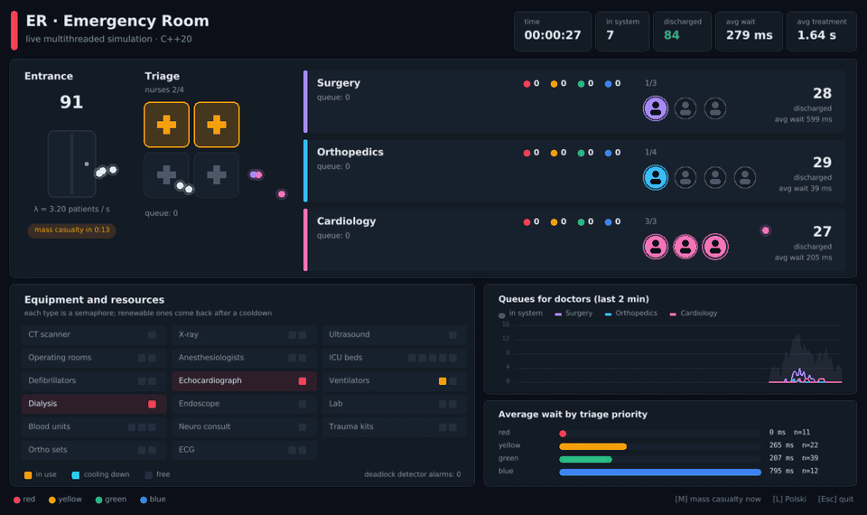
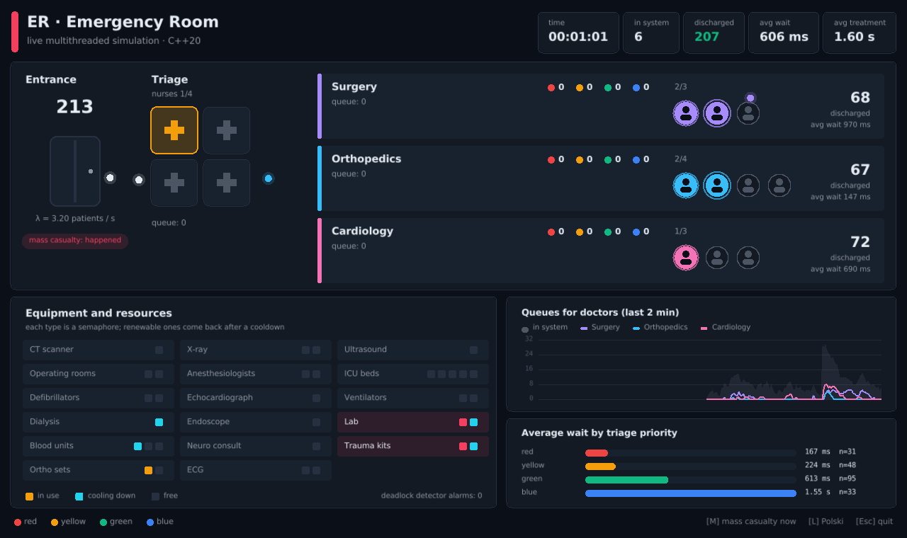
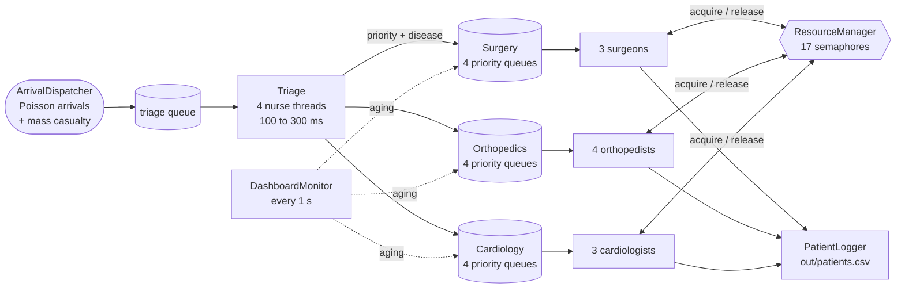
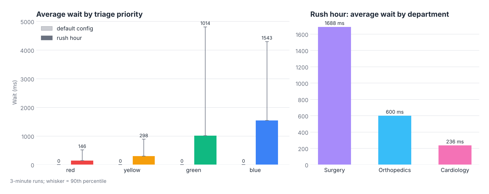

<p align="right">
  <a href="README.md"> <b>English</b></a>
  &nbsp;|&nbsp;
  <a href="README.pl.md"> Polski</a>
</p>

<a href="#see-it-in-action">
  <picture>
    <source media="(prefers-color-scheme: dark)" srcset="docs/banner-en-dark.svg" />
    <source media="(prefers-color-scheme: light)" srcset="docs/banner-en-light.svg" />
    
  </picture>
</a>

<p align="center">
  
  
  
  
  
</p>

<p align="center">
  <a href="#see-it-in-action"><b>Demo</b></a> &nbsp;·&nbsp;
  <a href="#live-window"><b>Live window</b></a> &nbsp;·&nbsp;
  <a href="#how-a-patient-moves"><b>How it works</b></a> &nbsp;·&nbsp;
  <a href="#what-the-runs-show"><b>Measurements</b></a> &nbsp;·&nbsp;
  <a href="#configuration"><b>Configuration</b></a> &nbsp;·&nbsp;
  <a href="#getting-started"><b>Getting started</b></a>
</p>

**Emergency Room Simulator** models a hospital emergency department as a set of cooperating threads, written for the *Operating Systems 2* course at Wrocław University of Science and Technology. Patients arrive at random, four triage nurses assign a priority and a department, and the doctors of three departments treat them while competing for 17 kinds of shared equipment, each one guarded by a semaphore.

Everything runs in real time. A **live window** shows the patient flow, the queues by priority, which doctors are busy, which equipment is taken or cooling down, and how the waiting times develop. The original terminal dashboard and the CSV logs keep working next to it.

## See it in action

<p align="center">
  
</p>

<p align="center"><sub>Recorded from the program running with <code>config/rush_hour.txt</code>, seconds 27 to 61. At second 40 a mass casualty event adds 25 patients at once: the triage nurses fill up, the queues grow, and the red patients still get through first.</sub></p>

## Highlights

<table>
  <tr>
    <td width="25%" align="center"><h3>20</h3><sub>long-lived threads<br/>plus short restock threads</sub></td>
    <td width="25%" align="center"><h3>17</h3><sub>equipment types,<br/>each a counting semaphore</sub></td>
    <td width="25%" align="center"><h3>4</h3><sub>priority levels with aging:<br/>nobody waits forever</sub></td>
    <td width="25%" align="center"><h3>10×</h3><sub>shorter wait for red than for blue<br/>patients in the rush hour run</sub></td>
  </tr>
</table>

- **One thread per actor.** 4 nurses, 10 doctors, the arrival generator, the deadlock detector, the metrics collector, the terminal dashboard and the patient logger each run in their own `std::thread`. The main thread draws the window.
- **Semaphores for equipment.** A doctor who needs the CT scanner calls `acquire("CT")` and blocks until one is free. Lab tests, blood units, dialysis and trauma kits are *renewable*: after use they come back only after a cooldown.
- **Priority queue with aging.** Each department keeps four FIFO queues (red, yellow, green, blue). A patient who waits too long moves up one level, so low priority patients are delayed but never starved.
- **Mass casualty events.** At a configured second (or when you press <kbd>M</kbd>) a whole group of patients arrives at once.
- **Clean shutdown.** <kbd>Ctrl</kbd>+<kbd>C</kbd>, closing the window or reaching `max_patients` wakes every waiting thread and stops the simulation within seconds.

## Live window

<p align="center">
  
</p>

| Part | What it shows |
|---|---|
| **Entrance** | patients that arrived, the arrival rate λ and a countdown to the mass casualty event |
| **Triage** | the four nurses (amber = busy) and the patients waiting for them |
| **Departments** | the queue as coloured dots by priority, the doctors (lit = treating), patients discharged and the average wait |
| **Equipment and resources** | every semaphore as a row of slots: amber = in use, cyan = cooling down, grey = free; a red tile is fully used |
| **Queues for doctors** | queue length of each department over the last two minutes, with the number of patients in the system behind it |
| **Average wait by priority** | how long patients of each triage colour waited for a doctor, live from the patient log |

Dots fly from the entrance to triage, from triage to the department that got the patient, and out to discharge, so you can follow the flow at a glance.

| Key | Action |
|---|---|
| <kbd>M</kbd> | Triggers a mass casualty event right now |
| <kbd>L</kbd> | Switches the window between Polish and English |
| <kbd>Esc</kbd> | Closes the window and stops the simulation (so does <kbd>Ctrl</kbd>+<kbd>C</kbd> in the console) |

## How a patient moves



1. **Arrival.** `ArrivalDispatcher` draws the time to the next patient from an exponential distribution (a Poisson process with rate λ). At `mass_casualty.at_second` it adds a whole group at once.
2. **Triage.** A free nurse takes the patient, spends 100 to 300 ms, picks one disease out of 21 (with a 20% chance of a second one) and draws a priority for each from the configured distribution. The most urgent disease decides the department.
3. **Queue.** The patient joins the department's `SafeQueue`, which holds one FIFO per priority. Doctors always take the most urgent patient first.
4. **Aging.** Once per second the dashboard thread promotes patients who have waited too long: blue to green after 18 s, green to yellow after 12 s, yellow to red after 8 s.
5. **Treatment.** The doctor examines the patient (200 to 500 ms) and then, depending on the department, uses equipment:
   - **Surgery:** 25% operation (anesthesiologist + operating room, then 50% ICU), otherwise a CT scan.
   - **Orthopedics:** 30% operation (operating room), otherwise X-ray followed by a trauma kit and an ortho set.
   - **Cardiology:** ECG, then 50% echocardiography and 30% defibrillation.
   - **Any department:** extra tools with a small chance each (ventilator, dialysis, lab, blood, endoscope, neuro consult, ultrasound).
6. **Discharge.** The patient is logged with the equipment used, the wait and the treatment time.

## Concurrency mechanisms

| Mechanism | Where | Purpose |
|---|---|---|
| Counting semaphore (`mutex` + `condition_variable`) | `sync/resource_manager` | access to 17 equipment types |
| Renewable resources | `sync/resource_manager` | DIAL 2 s, LAB 1.5 s, BLOOD 1.8 s, TRAUMA_KIT 1.2 s cooldown, done by a short detached thread |
| Priority queue with 4 levels | `sync/safe_queue` | doctors always take the most urgent patient |
| Aging | `sync/safe_queue` + `flow/department` | waiting patients move up a level, no starvation |
| Blocking queues (`condition_variable`) | `flow/triage`, `sync/safe_queue`, `output/patient_logger` | threads sleep until there is work |
| `std::atomic` | everywhere | `running` flag, busy and served counters |
| Deadlock detector | `sync/deadlock_detector` | raises an alarm when no resource changed for 3 checks in a row |
| Asynchronous logging | `output/patient_logger` | doctors hand log entries to a separate writer thread |

Resources are always taken in the same order (anesthesiologist before operating room, trauma kit before ortho set), so a circular wait between doctors cannot form. The deadlock detector is a safety net on top of that: it only looks for a long period without any change. Because of that it also fires when the emergency room is simply quiet, which you can see as the alarm counter in the window going up during calm minutes.

## What the runs show

Both presets were run for 3 minutes in the console (`config/config.txt` and `config/rush_hour.txt`, which differs only in the arrival rate and the mass casualty event).

<p align="center">
  <picture>
    <source media="(prefers-color-scheme: dark)" srcset="docs/en/waits-dark.png" />
    <source media="(prefers-color-scheme: light)" srcset="docs/en/waits-light.png" />
    
  </picture>
</p>

| | Default (λ = 0.8/s) | Rush hour (λ = 3.2/s, +25 at 40 s) |
|---|---|---|
| Patients treated | 134 | 587 |
| Average wait for a doctor | 0 ms | 835 ms |
| Average treatment | 1.24 s | 1.83 s |
| Wait: red / yellow / green / blue | 0 / 0 / 0 / 0 ms | 146 / 298 / 1014 / 1543 ms |
| Longest wait | 3 ms | 17.5 s (a blue patient) |

- **The default configuration hardly ever queues.** With 10 doctors and less than one patient per second, someone is almost always free, so waits stay at zero (the mass casualty event is scheduled at 300 s, after these 3 minutes).
- **Priorities work under load.** In the rush hour, red patients wait about a tenth as long as blue ones.
- **The single CT scanner is the bottleneck.** 75% of surgical patients need it, so surgery waits 1.7 s on average against 0.24 s in cardiology. Adding a second scanner (`equipment.ct = 2`) is the first thing to try.

## Configuration

The simulation reads a simple `key = value` file. Two presets live in `config/`:

| File | Use |
|---|---|
| `config/config.txt` | the original setup: calm emergency room, mass casualty at 5 minutes |
| `config/rush_hour.txt` | 4× more arrivals and a mass casualty of 25 patients at 40 s, good for watching queues and aging |

| Key | Meaning | Default file |
|---|---|---|
| `arrival.lambda_per_sec` | average arrivals per second | 0.8 |
| `arrival.mass_casualty.enabled` / `at_second` / `rate_per_sec` | the mass casualty event and its size | on, 300 s, 6 |
| `arrival.max_patients` | stop after this many patients have been treated (optional) | not set |
| `triage_distribution.red/yellow/green/blue` | priority probabilities | 0.10 / 0.20 / 0.50 / 0.20 |
| `staff.chirurg` / `ortopeda` / `kardiolog` | doctors per department | 3 / 4 / 3 |
| `equipment.*` | count of each of the 17 equipment types | e.g. `ct = 1`, `or = 2`, `icu_beds = 5` |
| `timeouts.backoff_min_ms` / `backoff_max_ms` | deadlock detector check interval and pause after an alarm | 1000 / 3000 |

Without an argument the program looks for `config.txt` and then `config/config.txt` in the working directory, and finally falls back to `config/config.txt` in the project folder, so it also works when started from CLion's build directory. To pick another file, pass it as the first argument.

## Outputs

- **Live window** described above.
- **Terminal dashboard** refreshed every second, with a final summary of waits, equipment use and department idle times.
- **`out/patients.csv`**: one row per patient with diseases, priority, department, equipment, treatment and wait time.
- **`out/metrics.csv`**: every 10 s the queue length of each department and the utilization of the CT scanner and operating rooms.

## Getting started

The window uses [raylib](https://www.raylib.com/) 5.5. You do not install it yourself: CMake downloads and builds it on the first configure, which needs Git and an internet connection once.

**CLion:** open the folder, let CMake load the project and run `SO2_P2`. To use the rush hour preset, add `config/rush_hour.txt` (or its full path) under *Run → Edit Configurations → Program arguments*.

**Command line:**

```bash
cmake -S . -B build -DCMAKE_BUILD_TYPE=Release
cmake --build build --parallel
./build/SO2_P2                          # config/config.txt
./build/SO2_P2 config/rush_hour.txt     # busier emergency room
```

Stop with <kbd>Esc</kbd> in the window or <kbd>Ctrl</kbd>+<kbd>C</kbd> in the console. The summary is printed and the program waits for <kbd>Enter</kbd>. Console messages are in Polish.

On Linux raylib needs the X11 and OpenGL development packages (on Ubuntu: `libx11-dev libxrandr-dev libxinerama-dev libxcursor-dev libxi-dev libgl1-mesa-dev`). Without a display the simulation runs in the console only.

## Project structure

```
.
├── CMakeLists.txt
├── config/
│   ├── config.txt              # default preset
│   └── rush_hour.txt           # busier preset for demos
├── src/
│   ├── main.cpp                # finds the config and starts the hospital
│   ├── core/                   # Hospital (orchestration), Config, parser, Patient, shared types
│   ├── flow/                   # ArrivalDispatcher, Triage, Department, Doctor, Registrar
│   ├── sync/                   # SafeQueue, ResourceManager (semaphores), DeadlockDetector
│   ├── output/                 # terminal dashboard, metrics CSV, patient log
│   └── view/                   # live window (raylib)
└── docs/                       # README visuals (EN / PL, light / dark)
```

<details>
<summary><b>Notes on the code</b></summary>
<br/>

- `Registrar` (a pre-triage registration desk) is implemented but not wired into `Hospital`; patients go from arrival straight to triage.
- `timeouts.deadlock_ms` and `staff.consultants.*` are read from the config but not used by the simulation.
- `mass_casualty.rate_per_sec` is the size of a single burst, not a rate over time.

</details>

---

<p align="center">
  <sub>Wrocław University of Science and Technology · Operating Systems 2 · Grzegorz Sienkiewicz</sub>
</p>
