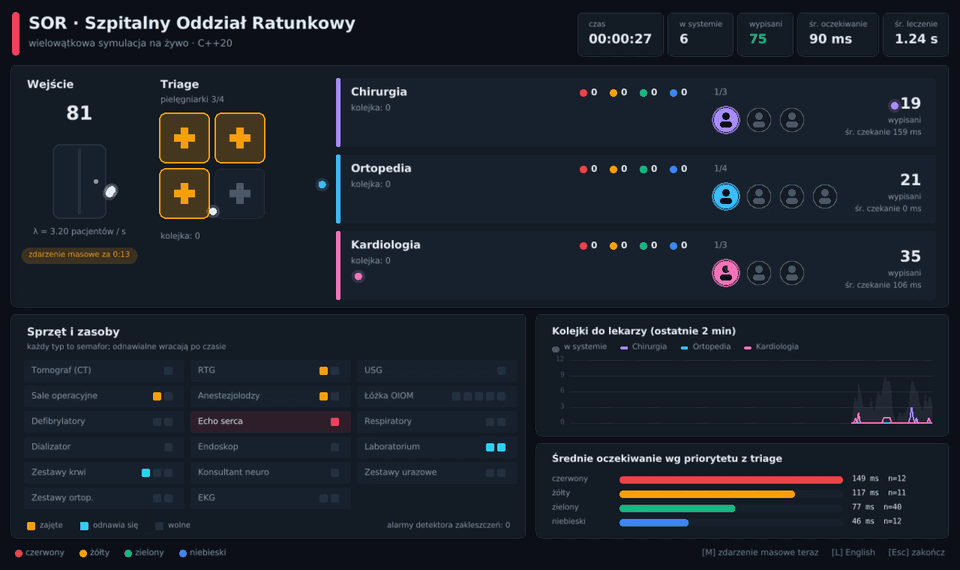
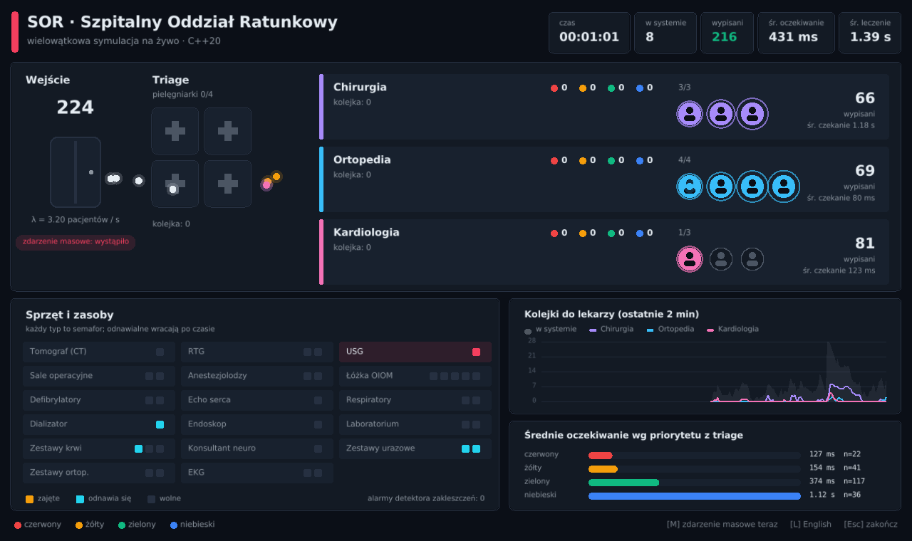
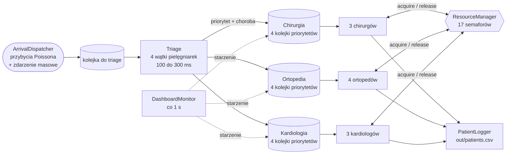
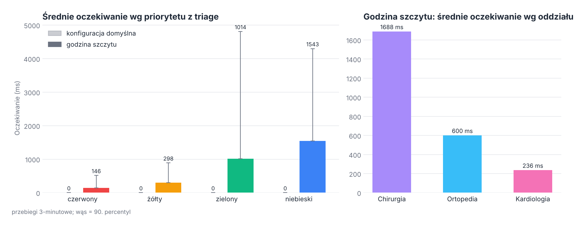

<p align="right">
  <a href="README.md"> English</a>
  &nbsp;|&nbsp;
  <a href="README.pl.md"> <b>Polski</b></a>
</p>

<a href="#zobacz-w-akcji">
  <picture>
    <source media="(prefers-color-scheme: dark)" srcset="docs/banner-pl-dark.svg" />
    <source media="(prefers-color-scheme: light)" srcset="docs/banner-pl-light.svg" />
    
  </picture>
</a>

<p align="center">
  
  
  
  
  
</p>

<p align="center">
  <a href="#zobacz-w-akcji"><b>Demo</b></a> &nbsp;·&nbsp;
  <a href="#okno-na-żywo"><b>Okno na żywo</b></a> &nbsp;·&nbsp;
  <a href="#droga-pacjenta"><b>Jak to działa</b></a> &nbsp;·&nbsp;
  <a href="#co-pokazały-pomiary"><b>Pomiary</b></a> &nbsp;·&nbsp;
  <a href="#konfiguracja"><b>Konfiguracja</b></a> &nbsp;·&nbsp;
  <a href="#uruchomienie"><b>Uruchomienie</b></a>
</p>

**Symulator SOR** odwzorowuje szpitalny oddział ratunkowy jako zestaw współpracujących wątków. Powstał na przedmiot *Systemy Operacyjne 2* na Politechnice Wrocławskiej. Pacjenci przychodzą losowo, cztery pielęgniarki na triage nadają im priorytet i oddział, a lekarze trzech oddziałów leczą ich, rywalizując o 17 rodzajów wspólnego sprzętu, z których każdy jest chroniony semaforem.

Wszystko dzieje się w czasie rzeczywistym. **Okno na żywo** pokazuje przepływ pacjentów, kolejki według priorytetu, zajętych lekarzy, zajęty i odnawiany sprzęt oraz to, jak zmieniają się czasy oczekiwania. Oryginalny dashboard w terminalu i logi CSV działają obok bez zmian.

## Zobacz w akcji

<p align="center">
  
</p>

<p align="center"><sub>Nagrane z działającego programu z <code>config/rush_hour.txt</code>, od 27. do 61. sekundy. W 40. sekundzie zdarzenie masowe dodaje naraz 25 pacjentów: pielęgniarki są zajęte, kolejki rosną, a czerwoni pacjenci i tak przechodzą pierwsi.</sub></p>

## Kluczowe wyniki

<table>
  <tr>
    <td width="25%" align="center"><h3>20</h3><sub>stałych wątków<br/>plus krótkie wątki odnawiania</sub></td>
    <td width="25%" align="center"><h3>17</h3><sub>rodzajów sprzętu,<br/>każdy to semafor zliczający</sub></td>
    <td width="25%" align="center"><h3>4</h3><sub>poziomy priorytetu ze starzeniem:<br/>nikt nie czeka w nieskończoność</sub></td>
    <td width="25%" align="center"><h3>10×</h3><sub>krócej czekają czerwoni niż niebiescy<br/>w godzinie szczytu</sub></td>
  </tr>
</table>

- **Jeden wątek na uczestnika.** 4 pielęgniarki, 10 lekarzy, generator przybyć, detektor zakleszczeń, zbieracz metryk, dashboard w terminalu i logger pacjentów działają każdy we własnym `std::thread`. Wątek główny rysuje okno.
- **Semafory na sprzęt.** Lekarz, który potrzebuje tomografu, wywołuje `acquire("CT")` i czeka, aż jakiś się zwolni. Laboratorium, zestawy krwi, dializa i zestawy urazowe są *odnawialne*: po użyciu wracają dopiero po czasie odnowienia.
- **Kolejka priorytetowa ze starzeniem.** Każdy oddział ma cztery kolejki FIFO (czerwona, żółta, zielona, niebieska). Kto czeka zbyt długo, przechodzi poziom wyżej, więc pacjenci z niskim priorytetem czekają dłużej, ale nie są zagłodzeni.
- **Zdarzenia masowe.** W zadanej sekundzie (albo po wciśnięciu <kbd>M</kbd>) przybywa naraz cała grupa pacjentów.
- **Czyste zamykanie.** <kbd>Ctrl</kbd>+<kbd>C</kbd>, zamknięcie okna albo osiągnięcie `max_patients` budzi wszystkie czekające wątki i zatrzymuje symulację w kilka sekund.

## Okno na żywo

<p align="center">
  
</p>

| Element | Co pokazuje |
|---|---|
| **Wejście** | liczbę przybyłych pacjentów, tempo przybyć λ i odliczanie do zdarzenia masowego |
| **Triage** | cztery pielęgniarki (bursztynowa = zajęta) i pacjentów czekających na nie |
| **Oddziały** | kolejkę jako kolorowe kropki wg priorytetu, lekarzy (podświetlony = leczy), wypisanych i średni czas oczekiwania |
| **Sprzęt i zasoby** | każdy semafor jako rząd miejsc: bursztynowe = zajęte, turkusowe = w odnowie, szare = wolne; czerwony kafelek jest zajęty w całości |
| **Kolejki do lekarzy** | długość kolejki każdego oddziału z ostatnich dwóch minut, a w tle liczba pacjentów w systemie |
| **Oczekiwanie wg priorytetu** | jak długo pacjenci z danym kolorem z triage czekali na lekarza, na żywo z logu pacjentów |

Kropki lecą od wejścia do triage, z triage na oddział, który przyjął pacjenta, i dalej do wypisu, więc przepływ widać od razu.

| Klawisz | Działanie |
|---|---|
| <kbd>M</kbd> | Wywołuje zdarzenie masowe od razu |
| <kbd>L</kbd> | Przełącza język okna między polskim a angielskim |
| <kbd>Esc</kbd> | Zamyka okno i zatrzymuje symulację (tak samo <kbd>Ctrl</kbd>+<kbd>C</kbd> w konsoli) |

## Droga pacjenta



1. **Przybycie.** `ArrivalDispatcher` losuje czas do następnego pacjenta z rozkładu wykładniczego (proces Poissona z intensywnością λ). W sekundzie `mass_casualty.at_second` dodaje naraz całą grupę.
2. **Triage.** Wolna pielęgniarka bierze pacjenta na 100 do 300 ms, losuje jedną z 21 chorób (z 20% szansą na drugą) i dla każdej priorytet z zadanego rozkładu. Najpilniejsza choroba decyduje o oddziale.
3. **Kolejka.** Pacjent trafia do `SafeQueue` oddziału, która ma osobną kolejkę FIFO na każdy priorytet. Lekarze zawsze biorą najpilniejszego.
4. **Starzenie.** Co sekundę wątek dashboardu awansuje pacjentów, którzy czekają za długo: niebieski na zielony po 18 s, zielony na żółty po 12 s, żółty na czerwony po 8 s.
5. **Leczenie.** Lekarz bada pacjenta (200 do 500 ms), a potem zależnie od oddziału korzysta ze sprzętu:
   - **Chirurgia:** 25% operacja (anestezjolog + sala operacyjna, potem 50% OIOM), w pozostałych przypadkach tomograf.
   - **Ortopedia:** 30% operacja (sala operacyjna), w pozostałych RTG, a po nim zestaw urazowy i zestaw ortopedyczny.
   - **Kardiologia:** EKG, potem 50% echo serca i 30% defibrylacja.
   - **Każdy oddział:** dodatkowy sprzęt z niewielkim prawdopodobieństwem (respirator, dializa, laboratorium, krew, endoskop, konsultacja neuro, USG).
6. **Wypis.** Pacjent trafia do logu ze sprzętem, czasem oczekiwania i czasem leczenia.

## Mechanizmy współbieżności

| Mechanizm | Gdzie | Po co |
|---|---|---|
| Semafor zliczający (`mutex` + `condition_variable`) | `sync/resource_manager` | dostęp do 17 rodzajów sprzętu |
| Zasoby odnawialne | `sync/resource_manager` | odnowa DIAL 2 s, LAB 1,5 s, BLOOD 1,8 s, TRAUMA_KIT 1,2 s w krótkim odłączonym wątku |
| Kolejka priorytetowa z 4 poziomami | `sync/safe_queue` | lekarze zawsze biorą najpilniejszego pacjenta |
| Starzenie (aging) | `sync/safe_queue` + `flow/department` | czekający awansują o poziom, brak zagłodzenia |
| Kolejki blokujące (`condition_variable`) | `flow/triage`, `sync/safe_queue`, `output/patient_logger` | wątki śpią, dopóki nie ma pracy |
| `std::atomic` | wszędzie | flaga `running`, liczniki zajętych i obsłużonych |
| Detektor zakleszczeń | `sync/deadlock_detector` | alarm, gdy żaden zasób nie zmienił się przez 3 kolejne sprawdzenia |
| Asynchroniczne logowanie | `output/patient_logger` | lekarze przekazują wpisy do osobnego wątku zapisującego |

Zasoby są zawsze brane w tej samej kolejności (anestezjolog przed salą operacyjną, zestaw urazowy przed ortopedycznym), więc cykliczne oczekiwanie między lekarzami nie może powstać. Detektor zakleszczeń jest dodatkowym zabezpieczeniem: szuka tylko dłuższego okresu bez żadnej zmiany. Dlatego zgłasza też alarm, gdy na SOR jest po prostu spokojnie, co widać w oknie jako rosnący licznik alarmów w cichych minutach.

## Co pokazały pomiary

Obie konfiguracje uruchomiłem na 3 minuty w konsoli (`config/config.txt` i `config/rush_hour.txt`, która różni się tylko tempem przybyć i zdarzeniem masowym).

<p align="center">
  <picture>
    <source media="(prefers-color-scheme: dark)" srcset="docs/pl/waits-dark.png" />
    <source media="(prefers-color-scheme: light)" srcset="docs/pl/waits-light.png" />
    
  </picture>
</p>

| | Domyślna (λ = 0,8/s) | Godzina szczytu (λ = 3,2/s, +25 w 40. s) |
|---|---|---|
| Obsłużeni pacjenci | 134 | 587 |
| Średnie oczekiwanie na lekarza | 0 ms | 835 ms |
| Średni czas leczenia | 1,24 s | 1,83 s |
| Oczekiwanie: czerwony / żółty / zielony / niebieski | 0 / 0 / 0 / 0 ms | 146 / 298 / 1014 / 1543 ms |
| Najdłuższe oczekiwanie | 3 ms | 17,5 s (pacjent niebieski) |

- **W domyślnej konfiguracji kolejki prawie nie powstają.** Przy 10 lekarzach i mniej niż jednym pacjencie na sekundę ktoś niemal zawsze jest wolny, więc oczekiwanie wynosi zero (zdarzenie masowe jest ustawione na 300 s, czyli po tych 3 minutach).
- **Priorytety działają pod obciążeniem.** W godzinie szczytu czerwoni czekają około dziesięć razy krócej niż niebiescy.
- **Wąskim gardłem jest jedyny tomograf.** Potrzebuje go 75% pacjentów chirurgii, więc chirurgia czeka średnio 1,7 s, a kardiologia 0,24 s. Pierwsze, co warto sprawdzić, to drugi tomograf (`equipment.ct = 2`).

## Konfiguracja

Symulacja czyta prosty plik `klucz = wartość`. W `config/` są dwie gotowe konfiguracje:

| Plik | Zastosowanie |
|---|---|
| `config/config.txt` | oryginalne ustawienia: spokojny SOR, zdarzenie masowe po 5 minutach |
| `config/rush_hour.txt` | 4 razy więcej przybyć i zdarzenie masowe z 25 pacjentami w 40. sekundzie, dobre do oglądania kolejek i starzenia |

| Klucz | Znaczenie | Plik domyślny |
|---|---|---|
| `arrival.lambda_per_sec` | średnia liczba przybyć na sekundę | 0,8 |
| `arrival.mass_casualty.enabled` / `at_second` / `rate_per_sec` | zdarzenie masowe i jego wielkość | włączone, 300 s, 6 |
| `arrival.max_patients` | zakończ po obsłużeniu tylu pacjentów (opcjonalne) | brak |
| `triage_distribution.red/yellow/green/blue` | prawdopodobieństwa priorytetów | 0,10 / 0,20 / 0,50 / 0,20 |
| `staff.chirurg` / `ortopeda` / `kardiolog` | lekarze na oddziale | 3 / 4 / 3 |
| `equipment.*` | liczba sztuk każdego z 17 rodzajów sprzętu | np. `ct = 1`, `or = 2`, `icu_beds = 5` |
| `timeouts.backoff_min_ms` / `backoff_max_ms` | odstęp sprawdzeń detektora i przerwa po alarmie | 1000 / 3000 |

Bez argumentu program szuka `config.txt`, a potem `config/config.txt` w katalogu roboczym, a na końcu bierze `config/config.txt` z folderu projektu, więc działa też po uruchomieniu z katalogu builda w CLion. Inny plik można podać jako pierwszy argument.

## Wyjścia

- **Okno na żywo** opisane wyżej.
- **Dashboard w terminalu** odświeżany co sekundę, z końcowym podsumowaniem czasów, użycia sprzętu i przestojów oddziałów.
- **`out/patients.csv`**: wiersz na pacjenta z chorobami, priorytetem, oddziałem, sprzętem, czasem leczenia i oczekiwania.
- **`out/metrics.csv`**: co 10 s długość kolejki każdego oddziału i wykorzystanie tomografu oraz sal operacyjnych.

## Uruchomienie

Okno korzysta z [raylib](https://www.raylib.com/) 5.5. Nie trzeba go instalować: CMake pobiera i buduje raylib przy pierwszej konfiguracji, do czego raz potrzebny jest Git i internet.

**CLion:** otwórz folder, poczekaj, aż CMake wczyta projekt, i uruchom `SO2_P2`. Żeby użyć godziny szczytu, wpisz `config/rush_hour.txt` (albo pełną ścieżkę) w *Run → Edit Configurations → Program arguments*.

**Wiersz poleceń:**

```bash
cmake -S . -B build -DCMAKE_BUILD_TYPE=Release
cmake --build build --parallel
./build/SO2_P2                          # config/config.txt
./build/SO2_P2 config/rush_hour.txt     # SOR w godzinie szczytu
```

Zatrzymanie: <kbd>Esc</kbd> w oknie albo <kbd>Ctrl</kbd>+<kbd>C</kbd> w konsoli. Program wypisze podsumowanie i poczeka na <kbd>Enter</kbd>.

Na Linuksie raylib potrzebuje pakietów deweloperskich X11 i OpenGL (na Ubuntu: `libx11-dev libxrandr-dev libxinerama-dev libxcursor-dev libxi-dev libgl1-mesa-dev`). Bez ekranu symulacja działa tylko w konsoli.

## Struktura projektu

```
.
├── CMakeLists.txt
├── config/
│   ├── config.txt              # konfiguracja domyślna
│   └── rush_hour.txt           # SOR w godzinie szczytu, do pokazów
├── src/
│   ├── main.cpp                # znajduje konfigurację i uruchamia szpital
│   ├── core/                   # Hospital (orkiestracja), Config, parser, Patient, wspólne typy
│   ├── flow/                   # ArrivalDispatcher, Triage, Department, Doctor, Registrar
│   ├── sync/                   # SafeQueue, ResourceManager (semafory), DeadlockDetector
│   ├── output/                 # dashboard w terminalu, metryki CSV, log pacjentów
│   └── view/                   # okno na żywo (raylib)
└── docs/                       # grafiki do README (EN / PL, jasne / ciemne)
```

<details>
<summary><b>Uwagi o kodzie</b></summary>
<br/>

- `Registrar` (rejestracja przed triage) jest zaimplementowany, ale nie jest podłączony w `Hospital`; pacjenci idą od wejścia prosto do triage.
- `timeouts.deadlock_ms` i `staff.consultants.*` są wczytywane z konfiguracji, ale symulacja ich nie używa.
- `mass_casualty.rate_per_sec` to wielkość jednej grupy, a nie tempo w czasie.

</details>

---

<p align="center">
  <sub>Politechnika Wrocławska · Systemy Operacyjne 2 · Grzegorz Sienkiewicz</sub>
</p>
